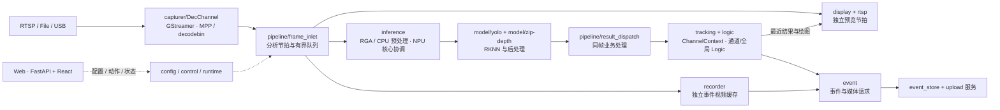

# RK3588 多路视觉分析框架

[](LICENSE)
[](engine/vendor/rockchip/PLATFORM_COMPATIBILITY.env)

面向 **Rockchip RK3588** 的 C++ 多路视觉分析框架：将视频接入、RKNN 推理、目标跟踪、业务规则、事件证据和 Web 运维组织成可配置的边缘应用。

*A C++ multi-stream vision analysis framework for RK3588, integrating RKNN inference, video pipelines, extensible application logic and Web management.*

开发者通过公开 C++ SDK 编写业务模块，复用采集、调度、录像、投递和部署能力。适用于多摄像头人员检测、区域告警、工业视觉和需要现场维护的边缘分析项目；具体识别效果与吞吐需按模型和现场负载验证。

**[快速开始](#快速开始) · [模型与业务接入](#模型与业务接入) · [性能与验证](#性能与验证) · [项目指南](docs/project-guide.md) · [SDK](docs/sdk/README.md) · [全部文档](docs/README.md)**

## 项目状态与兼容性

最近一轮本机硬件回归记录为 **2026-10-26**；以下环境与当前源码锁定信息、本机只读检查相符。其他板卡和发行版需要重新验收。

| 项目 | 已记录的验证范围 |
| --- | --- |
| 硬件 | RK3588 / AArch64；本机设备树报告 RK3588 EVB7 LP4 V10，约 8 GB RAM。原 README 记录作者使用 EAI-BOX-3000，不能据此推广到所有 RK3588 设备 |
| 系统 | Debian 11，Rockchip BSP 内核 `5.10.160` |
| NPU | RKNPU driver `0.9.0`；仓库固定 RKNN Runtime `2.4.2a2`，构建校验头文件与库哈希 |
| 视频栈 | 兼容基线记录 RGA driver `1.2.27`、Rockchip GStreamer MPP 插件 `1.14.4`；需匹配板卡 BSP |
| 扩展接口 | 公共源码 SDK `0.1.0`；业务随引擎编译，不提供独立插件 ABI |
| 容量 | 通道 ID 范围 `0–14` 是软件配置上限，**不代表 15 路已达到某种分辨率或帧率** |

版本依据：[平台基线](engine/vendor/rockchip/PLATFORM_COMPATIBILITY.env)、[Runtime 清单](engine/vendor/rknn/2.4.2a2/RUNTIME_MANIFEST.txt)、[SDK 版本](engine/include/version.h)。Ubuntu 有独立制包入口，尚不能等同于已验证的 Debian 组合；Armbian、RK3588S 和其他 SoC 未在这份基线中认证。

| 能力 | 当前状态与边界 |
| --- | --- |
| RKNN 与多模型 | 已实现 7 种模型适配；有文件输入混跑记录，以及 RTSP + USB 的自动/固定核心对照。具体覆盖见[实测报告](docs/npu-core-placement.md) |
| 视频输入与输出 | 已实现 RTSP、文件、USB 输入；有文件、局域网 RTSP、USB、HDMI 与 RTSP 输出回归。其他摄像头、USB 格式和显示设备需现场测试 |
| 跟踪与业务模块 | SORT、ByteTrack、通道/全局 Logic 已实现，有示例与软件测试；场景效果需评估 |
| 事件、Web 与恢复 | 已实现事件媒体、异步投递、Web 管理及故障恢复机制；对端、录像、GPIO、OTA 和长期运行需分别验收 |
| AI 辅助开发 | `develop_feature` 为实验入口，尚未开发完成；见[开发向导](docs/skills/rk3588-feature-wizard/SKILL.md) |

## 演示材料

目前没有整理成可公开核验的 Web 控制台、多路运行、跟踪或事件录像演示。仓库的 Logo/GIF 与深度示例输入图片不作为运行效果或性能证据。

待补充：控制台配置与实时画面截图、多路检测/跟踪短视频、事件前后录像示例。提交材料时请同时给出配置、模型、软件版本与拍摄日期，并隐去现场地址及账号；真实材料发布后再加入本节。

## 核心机制

- **按完整配置协调 NPU。** worker 持有独立 RKNN context；自动模型优先避开显式核心，自动通道数与可用核心数相等时按通道隔离，其余情况均衡共享。同核 SDK 生命周期互斥，不同核心可并行，故障后停止新提交；规划只在启动/热更新计算。[调度实现与边界](engine/src/inference/NPU_SCHEDULING.md)。
- **每个模型使用自己的输入尺寸。** 从 RKNN 张量查询宽高，从源帧分别生成输入，检测框、关键点、掩码和深度结果统一映射到 `640×640` 业务坐标。切换精度档位需要相应尺寸的 RKNN 权重。[坐标约定](docs/business-coordinates.md)。
- **硬件路径与 CPU 回退并存。** 合适的 DMA-BUF 输入可经 RGA 直接写 RKNN 输入内存；缺少 FD、需要补边/多边形处理等情况有 CPU 路径。RTSP 使用 MPP 解码，文件通过 decodebin 优先选择 MPP，编码按插件和 DMA 条件选择硬件或软件。**DMA-BUF 优先不等于全链路零拷贝**，绘图、JPEG、事件媒体仍可能转换和复制。
- **以新帧优先控制积压。** `max_fps` 控制分析节拍；有界队列满时淘汰最旧 pending 帧，`queue_size=1` 保留最新待处理帧，已开始的任务继续执行。较旧的完成结果不会覆盖较新的已发布结果；预览、分析和事件录像使用各自节拍。
- **业务模块与底层管线分离。** `ChannelContext`、`REGISTER_LOGIC`、`logic.json` 提供目标查询、参数、状态、ROI、绘图、动作和事件接口；全局 Logic 消费跨通道快照。新增业务随构建注册，无需复制采集/推理线程。[公开 SDK](engine/include/README.md)。
- **管理与投递可追踪。** Web 编辑配置、管理应用、查看画面和日志；C++ 写本地事件发件箱，独立上传服务维护各 delivery 的重试状态。热更新按字段和模块策略应用，拓扑变化需重启；保存成功不能代替运行日志确认。

## 快速开始

以下为 **RK3588 板端**流程，命令从仓库根目录开始。需要板卡厂商提供的可用 BSP、RKNPU/RGA/MPP 驱动和插件；普通桌面 Linux 依赖不能替代它们。构建依赖包括 CMake、C/C++ 编译器、OpenCV（含 FreeType）、GStreamer/RTSP Server、GTK3、libgpiod、Python 3；平台安装还需要 Node.js/npm，精确依赖由脚本及清单管理。

### 1. 准备环境

已有依赖时先做只读检查：

```bash
bash install_deps.sh --check
```

新设备可联网时执行平台统一安装：

```bash
sudo ./install.sh online
./install.sh status
```

安装器会准备依赖并部署 Web、运行管理和 GPIO 服务；**首次安装默认把继电器 `GPIO6_A2` 置低并保存状态**，连接设备前请核对板卡接线。依赖齐全且前端依赖/产物已准备好时可用 `sudo ./install.sh offline`。

首次断网部署使用同发行版、同版本 ARM64 制作的完整 bundle，执行包内 `install_offline.sh`。根目录 `install.sh offline` 不携带一套裸机安装依赖。详见 [Debian 离线包](tools/offline_dev_install/debian/README.md)、[Ubuntu 离线包](tools/offline_dev_install/ubuntu/README.md)及[部署细节](docs/project-guide.md#部署与离线交付)。

### 2. 先验证视频链路

准备一段自己的、MPP 可解码的 H.264 MP4。`/path/to/input.mp4` 是需要替换的占位路径；视频和大部分模型不会随 Git 检出自动具备。`readme_demo` 应使用一个新的应用名。

```bash
cp /path/to/input.mp4 projects/assets/input.mp4
./build.sh readme_demo
cp docs/examples/quickstart.json dist/readme_demo/assets/quickstart.json

cd dist/readme_demo
export ASSETS_DIR="$PWD/assets"
export LD_LIBRARY_PATH="$PWD/libs:$LD_LIBRARY_PATH"
./vision_analysis --validate-config ./assets/quickstart.json
./vision_analysis ./assets/quickstart.json
```

发布前检查交付资产：当前打包脚本会复制整个 `projects/assets/`，既有现场配置和媒体需要脱敏、筛选；不要把包含账号的配置当成通用示例。

[最小配置](docs/examples/quickstart.json)关闭 HDMI、业务 Logic 和推理，使用 `assets/input.mp4` 循环播放，开启 H.264 RTSP：`rtsp://<设备IP>:8554/live`。用 VLC/FFmpeg 等客户端打开；此时应有视频，**不会有模型推理结果**。

前台日志输出到当前终端，按 **Ctrl+C** 停止。先停止其他视觉实例再运行：框架使用进程级 NPU 占用锁，一个应用内部配置多通道。不要用 `run.sh` 替代上面的无界面命令；当前生成脚本会把所选配置的 `enable_display` 改成 `1`。

### 3. 开启模型推理

将兼容的 RK3588 RKNN 权重和对应标签放到应用的 `assets/`，修改 `assets/quickstart.json` 中通道 0 的 `infer_enable` 为 `true`，并把 `models` 替换为：

```json
[
  {
    "id": "detector",
    "enable": true,
    "model_type": "yolov8_det",
    "model_path": "assets/detector.rknn",
    "label_path": "assets/labels.txt",
    "obj_thresh": 0.3,
    "nms_thresh": 0.45,
    "detect_classes": [],
    "npu_core": -1
  }
]
```

这里的文件名是由你提供的资源名，不代表通用 YOLO 权重均可直接使用。先检查张量、再校验配置并启动：

```bash
./vision_analysis --inspect-model ./assets/detector.rknn
./vision_analysis --validate-config ./assets/quickstart.json
./vision_analysis ./assets/quickstart.json
```

开启 `performance_display` 后，日志 `[Perf][ch00]` 中应持续出现 `completed>0`、`failed=0`、非零 `infer_fps`，并核对 `published/publish_fps` 和实际结果。空场景可以没有目标框，进程存活或视频流畅都不能单独证明推理成功。多模型还需检查各子模型结果及异常日志。

`--validate-config` 检查结构与资源路径，不运行模型或连接视频；`--inspect-model` 查询 RKNN 元数据，也不能替代实际推理验证。

### 4. 用 Web 托管

停止前台程序，回到仓库根目录安装应用包：

```bash
cd ../..
sudo ./install_app.sh readme_demo
```

访问 `http://<设备IP>:8080`，用板端 Linux 系统账号登录，在程序管理中选择 `quickstart.json` 并启动；通过页面查看日志、实时画面并停止。平台日志可用 `journalctl -u rk3588-console.service -f`，引擎日志从具体应用页查看。[Web 使用说明](docs/skills/rk3588-console-ops/references/web-console-user-guide.md)。

本次文档验证范围及未执行的全新系统安装步骤见[验收记录](docs/benchmark.md#本次文档验收)。

## 模型与业务接入

### 已实现的模型适配

| `model_type` | 结果与契约 | 最近硬件回归证据 |
| --- | --- | --- |
| `yolov5` | YOLOv5 检测，需匹配输出头与标签 | 有 |
| `yolov8_det` | YOLOv8 检测，需匹配 DFL 输出布局与标签 | 有，含 640 / 1088 输入 |
| `yolov8_pose` | DFL 检测头与关键点布局 | 有，640×640，RTSP 混跑 |
| `yolo26_pose` | COCO17，one-to-many 输出契约 | 本轮缺对应权重 |
| `yolov5_seg` | 检测、mask 系数与 proto；含固定 proto 尺寸假设 | 有，640×640，混跑与同帧组合 |
| `yolo26_depth` | 米制深度输出契约 | 有，640×640 |
| `zip_depth` | 相对逆深度，越大越近，**不能直接解释为米** | 有，768×768 FP16 |

支持项由[模型工厂](engine/src/inference/inference_executor.cpp)、[配置校验器](engine/src/config/config_validator.cpp)与[能力目录](projects/catalog.json)共同约束。更换同类型权重无需新增 C++ 类型，但必须满足该后处理器的张量、类别、归一化和尺寸契约。深度和姿态可留空标签；检测和分割要求标签。

视频源在 `channels[].stream` 显式指定：

```json
{"src_type": "rtsp", "url": "rtsp://CAMERA_HOST/live", "video_enc": "h264"}
```

也可使用 `{"src_type":"file","url":"assets/input.mp4","loop":true}` 或 `{"src_type":"usb","device":"/dev/video0","usb_width":1280,"usb_height":720}`。地址、文件和 USB 采集档位必须按设备修改；添加通道使用唯一 ID，并同步调整显示网格。[完整配置约定](docs/skills/rk3588-src-modules/references/configuration.md)。

### 业务扩展入口

通道业务放在 `projects/modules/<模块>/logic.cpp + logic.json`，包含 `<channel.h>`，实现回调并 `REGISTER_LOGIC`；跨通道业务放在 `projects/global_modules/`，使用 `<global.h>` 与 `REGISTER_GLOBAL_LOGIC`。状态用 `ctx->get_state<T>()`，参数和输出在本模块清单中声明，重新构建后配置 `channels[].logic`。

最小 C++/清单、事件规则、模型类型扩展步骤见[项目指南](docs/project-guide.md#扩展模型与业务)，完整例子见[区域持续占用报警](projects/modules/logic_roi_dwell_demo/README.md)。事件通过 `EventRequest` / `report_event()` 提交，媒体与投递由 `report_policy` 配置；`accepted()` 不代表落盘或远端送达。[事件与上报](docs/skills/rk3588-console-ops/references/event-reporting.md)。

新模型类型需实现 `ModelBase` 并更新工厂、校验、能力目录及必要的 Web 元数据识别，重新编译；不存在任意模型自动适配或运行时动态加载业务 `.so` 的机制。

## 架构与目录



无模型通道走传统 CV worker；实时预览使用最新解码帧与最近结果叠加，事件/业务同帧一致性与预览低延迟分别处理。详细数据面、构建和部署控制面见[项目指南](docs/project-guide.md#技术架构)。

```text
engine/
  include/               公共业务 SDK
  src/capturer/          视频输入、重连与同源复用
  src/pipeline/          帧入口、结果分发与通道生命周期
  src/inference/         有界队列、模型实例、核心协调、坐标映射
  src/model/             YOLO / ZipDepth 模型适配与后处理
  src/tracking/          SORT / ByteTrack
  src/display/ + rtsp/   拼接、叠加、本地显示与 RTSP
  src/event/ + recorder/ 事件证据与录像
  tests/                软件测试、硬件回归与绘制微基准
projects/                通道/全局业务模块、资产与能力目录
web_console/             React 前端与 FastAPI 后端
services/framework/      投递、模型更新、运行管理、系统恢复与 GPIO
tools/                   构建清单、板端工具与离线制包
  device/                网络、GPIO、NPU 吞吐、逐层分析与定频工具
docs/                    SDK、配置、部署、验收与开发文档
build.sh                 应用构建和打包入口
install.sh               平台安装入口
install_app.sh           将应用包安装至 /opt/ai_apps
```

## 性能与验证

**2026-10-26，真实 RTSP + USB 三路混合推理**：RK3588 / 8 GB，RKNN `2.4.2a2`，每路 3 worker、queue=1、max_fps=25，SORT、1280×720 HDMI 和 H.264 RTSP 输出均开启。预热 15 秒、采集 60 秒，下表为各路成功推理 FPS：

| 核心配置 / 版本 | ZipDepth 768 FP16 | YOLOv5n 640 USB | YOLOv8 Pose 640 |
| --- | ---: | ---: | ---: |
| 手动 0/1/2，原基线 | 3.99 | 17.19 | 24.80 |
| 自动 / 1 / 2，修正前 | 10.28 | 10.47 | 9.03 |
| 自动 / 1 / 2，修正后 | 4.00 | 17.17 | 24.92 |
| 三路全自动，修正后 | 4.03 | 17.21 | 24.99 |

自动分配修正后，检测/姿态的 queue+worker 均值由 271.80 / 337.34 ms 降到 17.91 / 27.46 ms，恢复到手动分核水平。**这是资源隔离：深度由三核预算退回一核，其自身 FPS 降低**。新配置各路推理和发布 FPS 相同，旧部分自动的深度发布为 8.34 FPS；这些均值不是端到端延迟。

两个 RTSP 通道使用同一摄像头并共享解码器，USB 实际供帧约 17.2 FPS；这是整管线成绩，不能外推独立摄像头容量或裸模型吞吐。更多路数、同帧组合、逐路发布、CPU、哈希与原始窗口见[自动核心实测](docs/npu-core-placement.md)。[Benchmark](docs/benchmark.md)还保留历史文件输入与绘制微基准；不同条件不混成一个成绩。权重和全部现场素材未随报告公开，不能承诺任意设备精确复现数值。

端到端 P50/P95、统一丢帧率、完整内存/散热曲线及长期稳定性仍待补测。此前两轮输出/锁优化因发布率回退已撤回，见[历史实验](engine/src/inference/NPU_PERFORMANCE.md)；当前核心规划没有采用那些改动。

## 限制与故障排查

- 吞吐受模型、输入尺寸、量化、worker 数、解码并发、DDR、CPU 后处理、散热和输出负载共同影响；更多线程不保证更高吞吐。
- 同核请求会排队；未知 RKNN AUTO/绑核失败按全核心保护。不同进程的旧版或外部 RKNN 程序不一定遵守本框架占用锁。
- 模型宽高自动读取不等于支持任意导出结构；分割等适配器有布局限制。ZipDepth 的 `full_plus_roi` 只做整帧推理，避免合并不可比的裁剪相对深度。
- 热更新有边界：通道数量/ID/启用状态、显示/RTSP 拓扑及 `restart_required` 参数变化需重启，模型或源切换须检查实际应用日志。
- 录像、投递与恢复依赖可用磁盘、独立服务及硬件状态；已有短时回归不构成长期无人值守承诺。

| 现象 | 首先检查 |
| --- | --- |
| 找不到配置、视频、权重或标签 | 从应用根目录运行，核对 `assets/` 相对路径；模型和视频不保证都随 Git 提供 |
| OpenCV FreeType / RKNN 库 / MPP 插件缺失 | `bash install_deps.sh --check`；恢复匹配 BSP 和锁定 Runtime，勿随意替换系统库 |
| 模型能加载但无正确结果 | `--inspect-model` 查看张量；核对类型、标签、输出布局和归一化，再用真实帧推理 |
| 第二个实例提示 NPU 已占用 | 停止当前实例，在同一应用内增加通道；Web 也只托管一个运行中的视觉应用 |
| 预览有画面却无推理更新 | 确认 `infer_enable`、`performance_display`、`completed/published/failed`，并排查较旧结果丢弃 |
| RKNN `-22`、驱动超时或无法正常停止 | 保留应用及内核日志；恢复设备后重启推理，热更新不会清除故障标记，5 秒 SDK 超时不能保证取消卡住的 ioctl |
| Web 无视频、配置保存后无变化 | 开启 H.264 RTSP，核对客户端连接、配置阶段日志与需重启字段；见[运维排障](docs/skills/rk3588-console-ops/references/troubleshooting.md) |

待完善的验证工作包括：发布可获取的模型/视频/日志与运行演示、补齐 YOLO26 Pose 和更多尺寸变体、覆盖更多 BSP/摄像头、记录延迟分位数与长时资源曲线。这是待验证清单，不是已经交付的能力。

## 贡献与许可证

欢迎反馈可复现问题和提交改进。请附板卡、系统/驱动/Runtime、模型输入输出、脱敏配置、日志、复现步骤和已运行的测试；性能改动需逐路比较推理、发布和延迟。修改 Logic 前可运行 `python3 tools/build/generate_logics_catalog.py --check`；测试入口见 [Benchmark 文档](docs/benchmark.md#软件回归)和[项目指南](docs/project-guide.md#一致性检查)。

项目基于 [GNU GPL v3.0](LICENSE) 发布；第三方库、字体和模型遵循各自授权。现有作者联系方式：Sunny_Wei，`1927096839@qq.com`。

## 项目愿景

本项目受到 GNU 计划与自由软件运动的启发。我们相信，软件不应只是一个无法理解和修改的封闭工具，
也应当成为可以学习、验证、改进和继续传播的公共知识。开源的价值不仅是公开代码，更是让工程经验
能够被后来者继承，让不同开发者在清晰的规则和可复现的实现上继续创造。

我们希望这套框架能够为 RK3588 及其他边缘计算平台上的多路视觉应用提供一种可借鉴的实现思路：
底层能力集中建设，业务模块独立演进，配置和运行状态可视化，现场问题能够定位，
常见故障(网络波动，系统崩溃等)可自动修复，整套系统能长时间稳定运行。
如果它能让一位新人更容易理解系统、让一个算法更快落地、让一个团队少重复搭建一次基础设施或者
部署时让使用者少在命令行输入几行命令，这个项目也就实现了它的意义。

本项目融合了作者对边缘视觉的开发，部署，维护的全部理解。如果本项目对你的学习、研究或工程实践有
所帮助，欢迎 Star，提出建议或参与改进，让更多开发者能够发现、使用并共同完善它。

祝朋友们编程愉快！Happy coding！:)
