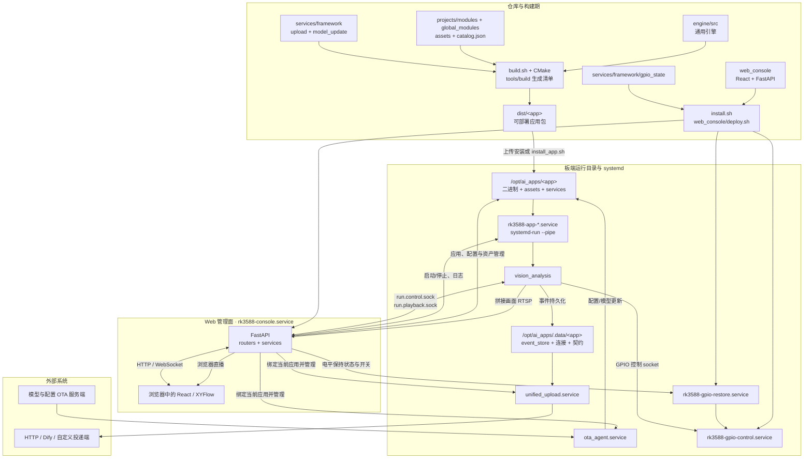
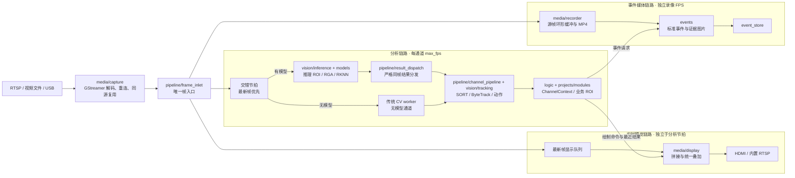

# 部署、架构与业务开发指南

本文说明部署、配置和业务扩展；命令与接口按当前工作区源码核对。首次运行从 [README 快速开始](../../README.md#快速开始) 开始；这里保留安装、离线交付、架构、配置与扩展细节。

**路径约定：代码块中的仓库路径以仓库根目录为起点；运行资源路径以应用工作目录为起点。**安装器和制包流程的说明来自源码核对，本次没有在全新系统重装平台。旧现场示例依赖作者自己的模型、视频、网络和模块，部分包含现场连接凭据；使用或发布前需脱敏并替换资源。最小示例位于 `docs/examples/quickstart.json`；现场配置与资源由部署者管理。打包脚本会复制整个 `projects/assets/`，交付前需检查其内容。

[技术架构](#技术架构) · [目录](#仓库结构) · [部署](#部署与离线交付) · [配置](#配置与坐标) · [扩展](#扩展模型与业务) · [事件](#告警事件与可靠上传) · [检查](#一致性检查)

## 技术栈

| 层次 | 主要技术 | 用途 |
|---|---|---|
| 硬件与运行平台 | Rockchip RK3588、AArch64、Linux、RKNPU、RGA、MPP、GPIO | 边缘部署、NPU 推理、图像转换、硬件编解码和现场设备控制 |
| 视觉分析引擎 | C/C++、CMake、POSIX Threads、OpenCV（含 FreeType）、cJSON、libgpiod | 多路分析管线、图像处理、业务 Logic、配置解析和 GPIO 控制 |
| AI 推理与跟踪 | RKNN Runtime `2.4.2a2`、YOLO、SORT、ByteTrack | RK3588 NPU 模型推理、检测/姿态/分割后处理及跨帧目标跟踪 |
| 视频与显示 | GStreamer、GStreamer RTSP Server、GTK3 | RTSP/File/USB 采集、解码、录像、拼接显示与 RTSP 输出 |
| Web 前端 | React 18、TypeScript 5、Vite 6、XYFlow、Zustand、Axios、xterm.js | 可视化画布、参数配置、实时状态、日志和浏览器终端 |
| Web 后端 | Python 3、FastAPI、Uvicorn、Pydantic、WebSocket | 应用管理、配置 API、实时日志、终端、设备与服务控制 |
| 配置与模块契约 | JSON、JSON Schema、声明式 `logic.json` | 通道配置、Logic 参数、动作、输出、上报字段和热重载校验 |
| 部署与运维 | Shell、systemd、离线 bundle、Debian/Ubuntu ARM64 | 一键安装、服务托管、离线交付、升级、检查与故障定位 |

其中 RKNN Runtime 随仓库固定版本并在构建时校验，Web 前端和后端的精确依赖版本分别以
`web_console/frontend/package.json` 和 `web_console/backend/requirements.txt` 为准。

## 技术架构

构建、部署与控制面：



`web_console/` 由根安装器独立部署到 `/opt/ai_apps/_console`；业务应用包由 `build.sh` 生成，
安装到 `/opt/ai_apps/<app>`。应用代码与持久数据分离，删除或替换应用包不会把
`/opt/ai_apps/.data/<app>` 中的事件、连接和上报契约混入程序目录。

视觉引擎内部数据面：



### 单帧运行链路

```text
GStreamer appsink
  → pipeline_submit_frame()
  ├─ 按录像自身 FPS → 事件视频源帧缓存
  ├─ 按预览安全上限 → HDMI/有客户端的 RTSP 最新帧队列
  └─ 每通道 max_fps 交错节拍
       ├─ 无模型通道：惰性保留源帧 → 单槽传统 CV worker
       └─ 推理通道：最新帧任务队列 → RGA/RKNN worker → 同帧结果分发
            → tracker
            → 构造 ChannelContext
            → 执行动作处理器与当前 logic_xxx
            → 原子写回 frame / results / state / draw commands
            → 显示叠加、事件图片和跨通道快照
```

业务发布与事件图片通过版本检查保持帧/结果一致；事件视频走独立源帧环形缓冲；实时预览优先显示
最新解码帧，并使用最近结果进行叠加，以降低观看延迟。

## 仓库结构

引擎各目录和构建定义的阅读入口见[引擎源码导航](../../engine/README.md)。

```text
.
├── engine/             # C++ 视觉分析引擎
│   ├── include/                # 公共业务 SDK
│   ├── src/
│   │   ├── application/        # main、config、control、runtime
│   │   ├── pipeline/           # 帧入口、结果分发与通道生命周期
│   │   ├── media/              # capture、display、recorder、rtsp
│   │   ├── vision/             # inference、models、tracking
│   │   ├── events/             # 事件、媒体任务与持久化
│   │   ├── dataset/            # 数据集采集规则
│   │   ├── logic/              # 通道/全局上下文、参数与注册
│   │   ├── platform/gpio/      # GPIO 平台实现
│   │   └── common/             # 内部通用工具
│   ├── vendor/                 # 锁定 RKNN、平台清单、第三方源码
│   ├── cmake/                  # 工具链、依赖、业务、主程序和测试定义
│   ├── tests/                  # 已有软件回归与硬件验证
│   └── CMakeLists.txt          # 构建入口
├── projects/                    # 二次开发内容的唯一迁移单元
│   ├── modules/                 # 可自由组合的通道 Logic
│   ├── global_modules/          # 可自由组合的全局 Logic
│   ├── assets/                  # 配置及用户提供的模型、标签、视频和字体
│   └── catalog.json             # 模型类型等共享能力
├── web_console/
│   ├── frontend/                # React、TypeScript、XYFlow、Zustand
│   ├── backend/                 # FastAPI 管理 API 与 WebSocket
│   └── deploy.sh                # 根安装器调用的 Web 控制台部署器
├── services/framework/
│   ├── upload/                  # 框架可靠事件上传服务
│   ├── model_update/            # 框架模型 OTA 服务
│   ├── runtime_manager/         # 应用生命周期、日志和恢复协调
│   ├── system_watchdog/         # 板端硬件看门狗集成
│   └── gpio_state/              # 框架 GPIO 开机恢复服务
├── tools/
│   ├── build/                   # Logic 清单和上报模板生成器
│   ├── device/                  # 独立板端诊断与配置工具
│   │   ├── first_net_config/    # 首次网络配置终端工具
│   │   └── gpio_test/           # GPIO 独立测试工具
│   └── offline_dev_install/     # 离线开发环境与安装包制作工具
│       ├── debian/              # Debian 制包入口与依赖清单
│       └── ubuntu/              # Ubuntu 制包入口与依赖清单
├── build/engine/                # CMake 中间产物（不提交）
├── dist/<app>/                  # 最终应用包（不提交）
├── docs/                        # 开发、运维和模块文档
├── develop_feature              # Codex/Claude 隔离式 Logic 需求澄清与自动开发入口
├── develop_feature.cmd          # 原生 Windows 的同一向导入口
├── build.sh                     # 仓库唯一的应用构建入口
├── install_app.sh               # 将 dist/<app>/ 安装到 Web 应用目录
├── install.sh                   # 平台统一安装、升级、状态与卸载入口
├── install_deps.sh              # 内部依赖准备或只读环境检查脚本
└── LICENSE                      # GPL-3.0
```

## 部署与离线交付

### 1. 环境要求

项目主要在搭载 RK3588 的 EAI-BOX-3000 边缘计算盒子上开发和验证：

- RK3588 / AArch64 Linux；
- 已验证 Debian 11 / Rockchip BSP；Ubuntu 有制包入口，其他发行版仍需验收；
- 可用的 Rockchip RKNPU 内核驱动和 RGA；RKNN 用户态 Runtime 已由项目固定；
- GStreamer 1.x；
- 带 `freetype` 模块的 OpenCV；
- 构建 Web 前端时需要 Node.js 18+。

“可以运行脚本”不等于“发行版之间二进制兼容”。尤其是离线仓库中的 FFmpeg、OpenCV、Python
和 systemd 软件包具有精确版本关系，必须遵守：

```text
制作机发行版 + 版本 + 架构 = 目标机发行版 + 版本 + 架构
```

例如 Debian 11 bundle 只能用于 Debian 11 ARM64，Ubuntu 22.04 bundle 必须在 Ubuntu 22.04
ARM64 制作。不要把 Debian bundle 强制安装到 Ubuntu，也不要通过降级系统库解决冲突。
硬件验证基线见
[平台兼容矩阵](../skills/rk3588-feature-wizard/references/platform-matrix.md)。

### 2. 统一安装

设备可以联网时，在项目根目录执行一条命令即可安装依赖、Web 控制台、GPIO 实时控制器和
电平保持服务：

```bash
sudo ./install.sh online
```

后续更新源码后直接重新部署，也可以随时查看安装状态：

```bash
sudo ./install.sh online   # 依赖或前端依赖发生变化
sudo ./install.sh offline  # 依赖齐全且前端已经构建
./install.sh status
```

根目录 `install.sh` 是面向使用者的唯一源码安装入口；`install_deps.sh`、
`web_console/deploy.sh` 和 `services/framework/gpio_state/install.sh` 是内部组件脚本。

联网安装需要在盒子仍能访问 APT、PyPI/npm 镜像时执行，会安装完整第三方运行依赖、
锁定安装前端依赖并预生成 `web_console/frontend/dist`。RKNPU 内核驱动、RGA、MPP 等
Rockchip BSP 组件不由该脚本安装；用户态 `librknnrt.so` 和 `rknn_api.h` 已固定在
`engine/vendor/rknn/`。APT 阶段只补装缺失包，不升级已经安装或被厂家设为
`hold` 的 BSP 包；单个无关软件源更新失败时，会使用其他成功更新的索引继续安装。
Python requirements 直接安装到系统 `/usr/bin/python3`，不会创建项目虚拟环境；已满足
版本约束的模块会由 pip 跳过。这与默认完整离线包采用相同的解释器和依赖规则。

如果目标设备明确只运行预编译应用，可以选择精简环境：

```bash
bash install_deps.sh --runtime-only
```

这属于高级依赖准备方式，不会完成 Web 控制台和 GPIO 服务部署。

现场设备不能访问 APT、PyPI 或 npm 时，在系统版本完全相同且可以联网的 ARM64 制作机上
生成环境与 Web 控制台安装包：

```bash
# 制作机必须和目标机使用相同发行版及版本
bash tools/offline_dev_install/debian/create_bundle.sh

# 已装过完整包且只修改源码时，生成快速源码更新包（不编译、不联网）
bash tools/offline_dev_install/debian/create_bundle.sh --source-only

# Ubuntu ARM64 使用对应入口（首次先运行 prepare_host.sh）
bash tools/offline_dev_install/ubuntu/prepare_host.sh
bash tools/offline_dev_install/ubuntu/create_bundle.sh --refresh-debs

# 把 output/full-bundle 复制到断网 RK3588，然后在包目录内一键安装
cd /userdata/full-bundle
sudo bash install_offline.sh
```

制包脚本会在制作机临时编译当前 C++ 程序以检测运行依赖，并构建前端，然后把系统依赖、
系统 Python requirements、Web 控制台和 Rockchip 用户态组件组成一个本地 APT 仓库。临时编译的
C++ 程序不会装入目标机的程序列表。目标机只需在所选 bundle 目录内运行
`install_offline.sh`，安装完成后可直接访问 `http://<RK3588-IP>:8080`，无需再执行
根目录安装器或手工安装依赖。默认完整包也包含源码、板端 C/C++ 编译环境、
ARM64 Node.js/npm 和前端 `node_modules`，源码入口为
`/userdata/rk3588_visual_analysis_framework`；目标机可以直接编译主程序和重新构建前端。
程序仍需由用户之后明确安装，或通过 Web 上传。
默认完整离线包的一键安装流程也会自动安装 GPIO 服务并在首次安装时将继电器置低，无需再
进入 `services/framework/gpio_state/` 执行命令。

日常源码迭代可复制 `tools/offline_dev_install/debian/output/source-update` 到已安装过完整包的设备，
并运行 `sudo bash install_source_update.sh`。依赖清单、前端锁文件或固定 RKNN 文件变化时，
快速模式会拒绝制包并提示重新生成 `full-bundle`；全新设备也始终使用完整包。

联网 `install_deps.sh` 和离线安装现在使用同一套系统 `/usr/bin/python3`；pip 对已经满足
requirements 约束的包会跳过，只补装缺失项或调整不兼容版本。两条路径都会核验模块导入和
依赖关系。仓库不会绑定项目源码哈希；发行版
软件包按制作机对应的软件源解析，开发机上由 dpkg 管理、但软件源没有的厂家用户态包才会重新
封装，项目固定的 RKNN Runtime 也会单独封装。完整包生成到
`tools/offline_dev_install/debian/output/full-bundle`，精简包生成到
`tools/offline_dev_install/debian/output/runtime-only-bundle`。升级时重新制包并再次运行安装脚本即可；新增依赖和
手工补包方法见
[Debian 说明](../../tools/offline_dev_install/debian/README.md) 或
[Ubuntu 说明](../../tools/offline_dev_install/ubuntu/README.md)。

如需单独排查厂家 BSP、硬件驱动或应用动态库，可运行只读诊断（它不是离线安装步骤，
诊断失败也不代表 deb 安装失败）：

```bash
bash install_deps.sh --check
# 只验收运行环境时：bash install_deps.sh --check --runtime-only
```

`--check` 会进行五层只读检测：系统/架构与已验证基线、RKNPU/RGA/MPP/DMA 设备、
Python/通用动态库、Rockchip GStreamer 硬件插件，以及项目和 `/opt/ai_apps` 中
实际可执行文件的 ELF 架构、`ldd` 和包内 RKNN Runtime 哈希。检测结果分为：

- `[通过]`：当前检查项符合要求；
- `[警告]`：可能可以运行，但驱动版本、可选硬件能力或应用包可追溯性尚未完全验证，
  命令返回值仍为 0；
- `[失败]`：存在会阻止核心功能运行的问题，命令返回非 0。

检查不会启动摄像头、模型或推理进程，因此静态检查通过后仍应使用现场摄像头、实际
`.rknn` 模型和 RTSP/录像输出做一次冒烟测试。项目已经验证的平台组合记录在
`engine/vendor/rockchip/PLATFORM_COMPATIBILITY.env`；只有完成硬件冒烟测试后
才应更新该基线。

已经用 `install_deps.sh` 或完整离线包准备好依赖时，可以使用离线模式完成统一安装。
源码更新后的目录如果没有前端产物，安装器会使用已有 `node_modules` 自动离线构建前端：

```bash
sudo ./install.sh offline
```

卸载统一安装的系统服务和控制台时使用：

```bash
sudo ./install.sh uninstall
```

卸载前会要求明确确认；应用包和 GPIO 保存状态会保留，已安装的控制台目录会移动到带时间戳
的备份目录。完整离线 bundle 仍然只需执行包内的 `install_offline.sh`，不需要再运行根安装器。
首次统一安装默认开启电平保持并将继电器 `GPIO6_A2` 置为低电平，后续升级会保留 Web 页面中
的开关状态和已经保存的 GPIO 电平。

`install_deps.sh` 是“联网预配置 + 断网验收”脚本，不包含 deb/wheel/npm 离线安装包；
因此不能把一台从未准备过的裸机带到无公网现场后再首次执行普通安装模式。

目标机仍需使用能正确启动 RK3588 的厂家内核、设备树和固件。离线仓库负责 RGA/MPP、
Rockchip GStreamer 和 RKNN 等用户态组件，但不会尝试用用户态 `.so` 替代内核驱动。

### 2.1 固定的 RKNN Runtime

编译和发布统一使用 `engine/vendor/rknn/2.4.2a2/` 中的 AArch64 Runtime，
不再根据构建设备的 `ldconfig` 顺序选择 `librknnrt.so`。CMake 和 `build.sh` 都会校验
头文件及 Runtime 的 SHA-256；文件缺失、被替换、架构或版本不符时构建会直接失败。

当前锁定并在 RK3588 / RKNPU driver v0.9.0 上验证的 Runtime 为：

```text
librknnrt version: 2.4.2a2 (5fd9678a8f@2026-04-27T15:52:16)
SHA-256: bf50d51705ae433013927a13520ae781b534fdb1481c47bdddbc726f63ed4970
```

### 3. 板端调试构建

```bash
# 先按首页准备 assets/input.mp4；从仓库根目录执行
cp docs/examples/quickstart.json projects/assets/quickstart.local.json
./build.sh --debug
cd projects
export ASSETS_DIR="$PWD/assets"
export LD_LIBRARY_PATH="$PWD/../engine/vendor/rknn/2.4.2a2/lib/aarch64:$LD_LIBRARY_PATH"
../build/engine/vision_analysis ./assets/quickstart.local.json
```

`--debug` 只生成可执行文件，不创建完整应用包。请根据设备修改视频源、模型和标签路径。
调试构建会使用项目锁定的 RKNN 头文件和 Runtime 进行链接；正式运行及跨设备验证请使用
完整发布包，以便由包内 `libs/librknnrt.so` 和 `$ORIGIN/libs` 保证运行时版本一致。

### 4. 构建发布包

```bash
./build.sh my_app
```

脚本会自动判断构建方式；当前锁定的 Runtime 为 AArch64，下面的 ARM 分支识别不等于已支持 32 位 ARM：

- AArch64：在板端原生编译；
- x86_64：需要事先准备脚本指定的 `rk3588_builder:2026_4_30` Docker 镜像及 sysroot；仓库没有提供一条可从空环境生成该镜像的已验证流程。

发布目录 `dist/my_app/` 包含：

- `vision_analysis` 可执行程序；
- `libs/` 动态库，其中 `librknnrt.so` 来自项目锁定版本并带版本清单；
- `assets/` 模型、标签和配置；
- `logics.json` Web 能力清单；
- `services/upload` 和 `services/model_update`；
- `report_templates/`、`run.sh` 和 `setup_python.sh`。

前台运行发布包：

```bash
cp docs/examples/quickstart.json dist/my_app/assets/quickstart.json
cd dist/my_app
OFFLINE=1 bash setup_python.sh  # 已执行根目录 install_deps.sh 的现场盒子
bash run.sh ./assets/quickstart.json
```

`run.sh` 会把所选配置的 `global.enable_display` 改为 1，适用于具备显示环境的前台调试。无界面运行请用首页的直接启动命令。生产托管请把完整包安装到 Web 控制台；
当前 `build.sh` 不生成历史文档中的 `deploy.sh`/`stop.sh`。

### 5. 安装 Web 管理平台

```bash
cd /userdata/rk3588_visual_analysis_framework
sudo ./install.sh online
```

该统一入口也会安装 GPIO 子系统；已经完成依赖准备且不允许联网时改用
`sudo ./install.sh offline`。

安装完成后访问：

```text
http://<RK3588-IP>:8080
```

控制台默认从 `/opt/ai_apps/` 扫描应用包。将刚构建的应用包安装到控制台：

```bash
sudo ./install_app.sh my_app
```

离线环境包不会自动执行这一步，也不会预装名为 `vision_analysis` 的程序。Web 程序列表只显示
用户明确上传或安装到 `/opt/ai_apps` 的应用。

### 6. 首次网络配置工具

`first_net_config` 是独立的 C/ANSI 终端工具，用于首次设置有线、Wi-Fi、设备名称、路由优先级，
以及检查网络冲突。它直接管理 NetworkManager，不依赖 Web 控制台：

```bash
cd tools/device/first_net_config
bash build.sh
sudo ./first_net_config
```

全屏界面使用 ANSI 转义序列和 Linux/POSIX 自带的 termios，不依赖 ncurses；源码构建只需要
CMake 和 C 编译器。源码仓库不跟踪该工具的生成二进制；在离线设备上使用前，应在匹配架构与系统的环境中编译并携带产物。完整功能、SSH
切换网络的回滚方式及高风险操作边界见
[tools/device/first_net_config/README.md](../../tools/device/first_net_config/README.md)。

## 新成员开发路径

建议按下面顺序熟悉项目，不要一开始就修改采集、推理和多线程核心：

1. 在独立测试设备上完成依赖安装、编译、发布包安装、启动、日志查看和删除。
2. 修改一个 `logic_course_xx` 示例，理解 `ChannelContext`、配置参数和绘制接口。
3. 独立新增一个小型通道 Logic，并完成配置校验和板端冒烟测试。
4. 根据个人方向进入 Web 前端、FastAPI 后端、设备工具或 C++ 引擎模块。
5. 最后学习离线制包、系统服务、网络修改和发布回滚。

对每次改动至少要求：能够编译、相关检查通过、异常路径验证、测试设备冒烟测试、文档同步更新，
并由另一名开发者完成代码审查。涉及密码、SSH、网络清理、systemd、文件删除和线程生命周期的
改动不得直接在生产设备上练习。

## 配置与坐标

配置没有根级版本号契约；OTA 模型版本只写在 `channels[].models[].version`。模型只允许写在
`channels[].models[]`；业务 ROI 只允许写在 `channels[].roi_zones[]`；通道级推理范围写在
`channels[].inference_roi`；录像设置只保存在 `report_policy`；`stream.src_type` 必须显式指定。
Web 画布中“业务 ROI”节点直接连接视频流节点，表示它归属于该视频通道。业务 ROI 即使在
没有模型的传统算法通道中也可以保存、显示并通过 `ChannelContext` 读取。每个通道可配置一个推理
多边形；矩形由四个顶点表示，矩形和任意多边形使用同一份配置结构。推理范围支持三种模式：
`roi_only`（只推理局部）、`full_plus_roi`（整帧推理一次、
局部再推理一次），以及 `full_frame_roi_filter`（保持整帧尺度推理一次，只输出区域内目标）。局部
取景可选 `stretch`（直接拉伸）、`expand`（扩展周边画面匹配模型比例，触边后只对不足部分补黑）
或 `letterbox`（保持比例并补黑边）。多边形使用 `stretch`/`letterbox` 时，多边形外的模型输入严格
填黑；使用 `expand` 时则保留扩展后的真实周边上下文。Web 编辑器以 640×640 参考画布预览取景，使用相同类型的偶数边界
对齐、缩放和填黑规则；实际输入的像素取整仍以加载模型的宽高为准。`roi_only` 和
`full_frame_roi_filter` 要求业务 ROI 的全部顶点和边完全位于推理区域内。检测框、姿态关键点和分割
掩码都会使用完整画面坐标；结果受限模式还会清除区域外掩码，
检测/姿态等 `full_plus_roi` 的两批结果则会执行跨批次 NMS，因此业务逻辑不需要感知推理裁剪或结果过滤。
已配置的推理 ROI 会作为青色边框叠加到实时显示、带叠加的录像和上报图片；该边框只在推理完成后的
统一输出渲染阶段绘制，不会进入模型输入或污染业务逻辑读取的源帧。

业务画布固定为 **640×640**，与视频源分辨率、模型实际输入尺寸独立。模型读取 `.rknn` 中的
输入宽高，并从原始视频缓冲直接生成所需输入；检测框、姿态关键点和分割掩码在进入跟踪/业务逻辑前
统一映射到完整画面的 640×640 坐标。启动顺序、模型热切换和重启不会改变业务坐标。
因此原来的 `(320,320)` 中心、业务像素距离/面积阈值和 ROI 均可沿用；更改摄像头取景或裁剪方式后，
仍需检查物理测量标定。分割模型的输出结构须与解码器兼容，固定业务画布不代表所有模型已支持任意尺寸。

业务代码可用 `ctx->business_width()` / `business_height()` / `business_size()` / `business_center()`
查询画布，不触发取帧。`ctx->business_frame()` 使用惰性生成的 640×640
BGR 缓存；只有读取像素时才转换。`ctx->source_frame()` 保留原图尺寸，原图上的检测坐标需显式按
`src_width/640`、`src_height/640` 转换。模型实际输入尺寸通过模型检查 SDK 获取。
坐标约定、迁移示例和回归验证见 [固定业务坐标与模型输入尺寸](../reference/business-coordinates.md)。

以下为字段组合示例；RTSP 地址、`assets/yolov8n.rknn` 与标签均为占位资源，必须替换后才能校验运行。深度类型还有独立的 ROI 语义，不直接套用检测的两批合并策略。

```json
{
  "global": {
    "enable_display": false,
    "enable_rtsp": true,
    "disp_width": 1280,
    "disp_height": 720,
    "tile_cols": 1,
    "tile_rows": 1,
    "max_fps": 25,
    "queue_size": 1
  },
  "channels": [
    {
      "id": 0,
      "enable": true,
      "infer_enable": true,
      "stream": {
        "src_type": "rtsp",
        "url": "rtsp://192.168.1.10/live",
        "video_enc": "h264"
      },
      "models": [
        {
          "id": "detector",
          "enable": true,
          "model_type": "yolov8_det",
          "model_path": "assets/yolov8n.rknn",
          "label_path": "assets/labels.txt",
          "version": "",
          "obj_thresh": 0.3,
          "nms_thresh": 0.45,
          "detect_classes": [],
          "npu_core": 0
        }
      ],
      "inference_roi": {
        "mode": "full_plus_roi",
        "resize_mode": "expand",
        "polygon": [[0.25, 0.2], [0.75, 0.25], [0.68, 0.8], [0.3, 0.72]]
      },
      "logic": "logic_default",
      "logic_parameters": {},
      "roi_zones": [
        {
          "name": "entrance",
          "polygon": [[0.1, 0.1], [0.9, 0.1], [0.9, 0.9], [0.1, 0.9]]
        }
      ],
      "report_policy": {
        "enabled": false,
        "deliveries": []
      }
    }
  ]
}
```

通道 `id` 是运行时、Web API、告警、录像和控制动作共同使用的唯一身份，必须唯一且位于 `[0, 15)`。

只校验配置而不启动视频、NPU 和后台线程：

```bash
cd projects
../build/engine/vision_analysis --validate-config ./assets/quickstart.local.json
```

ZipDepth 相对逆深度在不同裁剪间没有共同尺度，因此 `full_plus_roi` 仅执行整帧；米制与相对深度通过 `AlgoResult::depth_kind` 区分。模型输入尺寸不从文件名或 sidecar JSON 推断，不能只修改配置宽高来改变 RKNN 网络尺寸。详见 [ZipDepth 适配说明](../../engine/src/vision/models/zip-depth/README.md)。


## 扩展模型与业务

### 接入一份同类型权重

1. 使用面向 RK3588 导出的 RKNN 文件，放入应用 `assets/`；`yolov5`、`yolov5_seg`、`yolov8_det` 同时提供匹配标签；OBB、姿态和深度可留空。
2. 在 `channels[].models[]` 写明唯一 `id`、`model_type`、资源路径、阈值与 `npu_core`。
3. 用 `vision_analysis --inspect-model <路径>` 查看张量，用 `--validate-config` 检查配置和文件存在性。
4. 在 RK3588 上用真实视频核对数值、类别、坐标、普通/DMA 入口以及各模型结果；加载成功不等于后处理契约相符。

`model_path` 决定实际输入尺寸，各子模型分别从源帧预处理，最终映射回 640×640。新尺寸需要新导出的权重。当前分割和姿态后处理含特定布局假设；不要将同一个 family 名字当成所有导出版本通用。

### 新增模型类型

这需要修改引擎并重新构建，属于独立代码任务：

- 以 `engine/src/vision/models/model_base.h` 的 `ModelBase` 为接口，实现普通输入、尺寸查询、阈值与结果语义；可选实现 `get_input_fd()` / `get_input_rga_handle()` / `infer_zero_copy()`。
- 在 `engine/src/vision/inference/inference_executor.cpp` 的 `create_inference_model()` 中添加构造分支，供启动和重载共用。
- 同步 `engine/src/application/config/config_validator.cpp` 的类型及标签规则、`projects/catalog.json` 和 Web 的模型类型枚举；张量兼容性规则统一扩展 `engine/src/vision/models/model_compatibility.cpp` 的公共 SDK 实现，Web 的 `model_info.py` 只转发 SDK 检查结果。
- SDK 提交统一通过 `engine/src/vision/inference/npu_execution.h`，并正确记录实际生效的核心掩码；输出缓冲遵守 `npu::Outputs` 生命周期。新增模型不能绕过公共调度直接调用 RKNN 提交接口。
- 输出使用 `AlgoResult`，保留 `model_id/model_type/model_index`；新结果语义需要同步公共接口、坐标映射、业务查询与渲染，不能仅让模型工厂“能加载”。
- 增加张量契约、数值/坐标及同核/异核混跑回归，验收推理、发布和延迟；见 [NPU 调度](../../engine/src/vision/inference/NPU_SCHEDULING.md)与 [Benchmark](../performance/benchmark.md)。

### 新业务与事件规则

Logic 是编译期注册模块，优先使用 `engine/include/` 的公开接口，业务不要直接依赖引擎内部头文件。通道 Logic 注册 `REGISTER_LOGIC`，全局 Logic 注册 `REGISTER_GLOBAL_LOGIC`；每个模块有自己的 `logic.json`。

下面保留最小通道例子。需要区域、计时和事件时，参考 [ROI 持续占用模块](../../projects/modules/logic_roi_dwell_demo/README.md)，按模块 Schema 声明参数、输出、事件类型与上报字段。业务规则写在模块中；图片/录像选择、投递连接与接口映射写在 `report_policy`。全局实例按状态发布唤醒，快速连续更新可能合并，计时使用实际时间差。


## 开发新的通道逻辑

每个通道逻辑由一个 C++ 入口和一个模块清单组成：

```text
projects/modules/logic_people_count/
├── logic.cpp
└── logic.json
```

最小 `logic.cpp`：

```cpp
#include <channel.h>
#include <string>
#include <drawing.h>  // 公共接口：engine/include/

static void logic_people_count(ChannelContext *ctx)
{
    TargetQuery query;
    query.labels = {"person"};
    const int count = ctx->query_targets(query).count;
    draw_text(ctx,
              ("person: " + std::to_string(count)).c_str(),
              cv::Point(20, 40),
              cv::Scalar(0, 255, 0));
}

REGISTER_LOGIC(logic_people_count);
```

最小 `logic.json`：

```json
{
  "label": "人员计数",
  "event_types": [],
  "parameters": {
    "type": "object",
    "additionalProperties": false,
    "properties": {}
  },
  "report_fields": []
}
```

新增模块后重新运行 CMake 或 `build.sh`。构建过程会：

1. 递归收集 `projects/modules/` 中的 C++ 源文件；
2. 从 `REGISTER_LOGIC()` 获取唯一 logic ID；
3. 校验 `logic.json`、参数访问器和热重载策略；
4. 将 Schema 嵌入二进制；
5. 在发布包中生成供 Web 使用的 `logics.json`。

普通模块参数应声明在 `logic.json.parameters.properties`，运行时通过以下接口读取：

- `ctx->param_float()`；
- `ctx->param_int()`；
- `ctx->param_bool()`；
- `ctx->param_string()`；
- `ctx->param_json()`。

不要使用函数内 `static` 保存每通道状态；新代码的跨帧状态应优先通过 `ctx->get_state<T>()` 管理，旧代码仍可使用 `ctx->state`，以避免不同的通道逻辑混用变量。

## 内置业务逻辑

完整模块索引统一维护在[当前业务示例](../skills/rk3588-channel-logic/references/current-examples.md)，
每个模块的参数和事件以其 `logic.json` 为准。实际注册结果通过同版构建的
`--list-logics`、`--list-global-logics` 查询。

通道可以省略 `logic`；此时仍运行视频、模型、跟踪和通用绘制，但不调用业务回调。
数据集采集通过 Web 独立配置，不占用业务 Logic，见[采集指南](dataset-collection.md)。

全局实例由通道新发布唤醒，`poll_interval_ms` 是无更新时的兜底周期；
应使用 `timestamp_ms`/`dt_ms` 计时，不能把回调次数当成固定时钟。
快速连续发布可合并为一次最新状态回调。


## 配置热重载

运行时监控当前配置文件，等待文件写入稳定后重新解析。当前支持：

- 阈值、检测类别、队列深度和跟踪参数更新；
- ROI 和 logic 参数更新；
- logic 切换及状态安全清理；
- 模型热替换；
- 视频源地址和 USB 参数切换；
- 全局逻辑实例重启；
- 模块参数的 `preserve_state`、`reset_state`、`restart_required` 策略。

以下变化涉及固定运行拓扑，热重载会拒绝并要求重启：

- 通道数量、ID 或启用状态变化；
- HDMI/RTSP 输出开关、布局、端口、编码等输出拓扑变化。

配置采用不可变运行快照发布。业务帧持有快照后，本帧所见的通道配置、ROI 和模块参数保持一致。

热更新按阶段应用。模型/视频源切换可能失败并回退对应字段；解析成功或 Web 保存成功，不代表所有子系统都已接受新值。请核对各阶段日志及最终运行快照，参见 [热重载事务](../skills/rk3588-src-modules/references/configuration.md#热重载事务)。


## 告警事件与可靠上传

业务逻辑只调用统一入口：

```cpp
EventRequest request;
request.event_type = "person_enter";
request.message = "检测到人员进入";
request.fields = {
    event_field("label", "person"),
    event_field("count", 1),
};
EventReportResult report = report_event(ctx, request);
if (!report.accepted())
    fprintf(stderr, "report rejected: %s (%s)\n",
            event_report_status_name(report.status), report.detail.c_str());
```

媒体类型、叠加方式、视频前后时间窗、接收端和字段映射由 Web 保存的 `report_policy` 决定。
`report.accepted()` 只表示创建/合并请求已进入本地持久化队列，不表示已经落盘或远端成功；失败时
通过 `status/detail` 精确定位。

事件链路：

```text
channel logic / global logic
  → event_store/<event_id>/event.json
  → media_state.json / delivery_state.json
  → annotated.jpg / raw.jpg / clip.mp4
  → unified_upload 扫描
  → delivery 独立上传和重试
  → 全部成功后删除事件目录
```

全局逻辑使用同一个 `EventRequest` 与 `report_event(gctx, request)`。聚合事件通过
`evidence_channel_ids` 描述本次涉及的通道；Web 上报节点决定图片使用证据通道、指定通道或全部
画布连入通道，并按全局显示尺寸和网格拼接。聚合事件没有主通道，`source_channel_id` 只用于
确实来自单路通道的来源元数据，不参与媒体选择。事件视频固定使用全局节点明确配置的
`media_source_channel_id`。Web 画布以“通道逻辑 → 全局逻辑 → 上报配置”连线生成输入和上报策略。

事件目录按写入者拆分：C++ 维护 `event.json` 和 `media_state.json`，并初始化
`delivery_state.json`；此后上传服务独占 delivery 状态，避免两个进程并发覆盖同一份状态。

默认发件箱上限为 1 GiB，并保留至少 512 MiB 可用磁盘空间。可以通过以下环境变量覆盖：

- `EVENT_STORE_DIR`；
- `EVENT_STORE_MAX_BYTES`；
- `EVENT_STORE_MIN_FREE_BYTES`。

## 一致性检查

校验所有 logic 注册、模块清单、参数 Schema 和 C++ 参数访问器：

```bash
python3 tools/build/generate_logics_catalog.py --check
```

编译后查看二进制实际注册的通道逻辑：

```bash
build/engine/vision_analysis --list-logics
```

构建 Web 前端：

```bash
cd web_console/frontend
npm ci
npm run build
```

运行 Web 后端测试：

```bash
cd web_console/backend
PYTHONPATH=. python3 -m pytest -q tests
```

修改安装脚本后检查 Shell 语法：

```bash
bash -n install_deps.sh \
  tools/offline_dev_install/debian/create_bundle.sh \
  tools/offline_dev_install/debian/templates/install_offline.sh \
  build.sh
```

测试通过只说明软件层面的静态行为符合预期。涉及摄像头、NPU、RGA/MPP、GPIO、显示、RTSP 或
系统网络的修改，仍须在独立 RK3588 测试设备上进行硬件冒烟测试。

## 项目边界

- 通道 logic 是编译期模块，不是运行时动态加载的 `.so` 插件；
- Web 图编辑器编排固定的视觉分析角色，暂不支持用户自定义 DAG；
- 模型类型由 C++ 模型工厂注册，新增类型需要重新编译；
- 全局 logic 与通道 logic 一样是编译期自注册模块；
- Web 只允许从当前 App 的 Logic 清单选择已注册模块。
