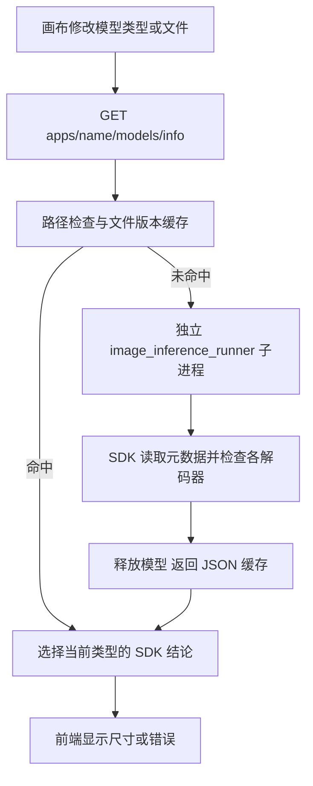

# 模型检查 SDK 与 Web 画布执行流程

公共头文件为 [model_inspection.h](../../engine/include/model_inspection.h)，实现组件为
`Vision::ModelInspection`；`Vision::Inference`、`Vision::Analysis`、`Vision::Runtime` 也传递链接它。
模型信息读取和所有解码器兼容性规则由 C++ SDK 实现，Web 不再维护 Python 版张量规则。

## 独立调用

| 接口 | 作用 | 是否加载 RKNN |
| --- | --- | --- |
| `inspect_model(path)` | 返回自有存储的输入/输出元数据和探测错误 | 是，返回前释放临时上下文 |
| `check_model_compatibility(metadata, type)` | 检查输入、张量形状及指定解码器的要求 | 否，纯 CPU，无文件访问 |
| `check_model_file(path, type)` | 一次完成探测与兼容性检查 | 是，仅一次 |
| `inference_model_types()` | 枚举模型类型、结果种类和标签需求，检查器与真实模型工厂共用目录 | 否 |

```cpp
#include <model_inspection.h>
#include <iostream>

int main(int argc, char **argv) {
    if (argc != 2) return 2;
    const auto checked = vision::check_model_file(argv[1], "yolov8_det");
    if (!checked.ok()) {
        std::cerr << checked.error() << '\n';
        return 1;
    }
    std::cout << checked.compatibility.input_width << " x "
              << checked.compatibility.input_height << '\n';
    // 可以复用这些元数据检查其他类型，无需再次加载模型。
    const auto another = vision::check_model_compatibility(
        checked.inspection.metadata, "yolov5");
    std::cout << "YOLOv5 compatible: " << another.ok << '\n';
    return 0;
}
```

元数据包含每个张量的名称、shape、布局、数据类型、元素数、量化类型、scale、zero point 和
小数位信息。公共结构不包含 RKNN 句柄、厂商头文件、OpenCV、JSON 或视频接口。
探测器允许读取多输入模型的信息；兼容性检查会明确拒绝当前解码器不支持的多输入模型。

完整可执行示例会列出所有解码器的判断结果，并按命令行指定类型返回状态码：

```bash
engine/sdk_standalone_tests/build_cpp.sh engine/sdk_standalone_tests/model_inspection
engine/sdk_standalone_tests/model_inspection/model_inspection /absolute/path/to/model.rknn yolov8_det
```

编译只需指定源文件夹，支持目录内多个 C/C++ 源文件和头文件。可执行文件直接生成在该文件夹内，构建缓存位于 `build/`。
可换成自己的源文件夹，在源码中包含 `<model_inspection.h>` 即可使用这些接口，公共编译脚本统一负责 SDK 链接。
脚本首次构建完整 SDK；自有 CMake 工程可按需只链接 `Vision::ModelInspection`，该组件不引入
OpenCV、视频、GUI 或业务实现。运行探测需要 RK3588 的 RKNN 运行库与设备。
纯兼容性检查也可使用自己构造的 `ModelMetadata`，不访问 NPU。

模型列表来自 [model_catalog.inc](../../engine/src/vision/models/model_catalog.inc)，检查器和推理工厂各自展开同一目录，避免分别维护列表。

## 实现和边界

- [model_probe.cpp](../../engine/src/vision/models/model_probe.cpp)：`rknn_init` → `rknn_query` → `rknn_destroy`。
  临时上下文由 RAII 管理，查询失败也会释放；同一进程的并发探测串行化，SDK 不保存文件缓存。
- [model_compatibility.cpp](../../engine/src/vision/models/model_compatibility.cpp)：纯 C++ 规则，包括单输入、
  batch=1、RGB 布局、元素数与 shape 一致性，以及检测头、关键点、分割 proto、深度输出的要求。
- [model_inspection_cli.cpp](../../engine/src/application/tools/model_inspection_cli.cpp)：SDK 的 JSON/stdio 适配层，
  返回 `MODEL_INFO_JSON=` 前缀和 `inspection_version: 1`；不包含 RKNN 操作或解码器规则。

检查不调用 `rknn_run`，不验证识别精度、训练类别语义或实际图片效果。这些需要真实推理。
SDK 是同步接口；调用者负责超时和调用频率，Web 通过独立子进程设置 20 秒超时。

两个引擎入口都支持手动检查，后一个类型参数可省略：

```bash
image_inference_runner --inspect-model /absolute/path/to/model.rknn yolov8_det
vision_analysis --inspect-model /absolute/path/to/model.rknn yolov8_det
```

## 现在 Web 画布如何检查

1. 用户在画布模型节点修改模型类型、模型文件，或者上传使资源列表更新。
   [NodeConfigPanel.tsx](../../web_console/frontend/src/components/NodeConfigPanel.tsx) 将当前
   `app/path/modelType/assetsRevision` 传给 [ModelInformation.tsx](../../web_console/frontend/src/components/ModelInformation.tsx)。
2. `ModelInformation` 发起 `GET /api/apps/{name}/models/info?path=assets/xxx.rknn&model_type=...`。
   旧选择的晚到响应不会覆盖新选择。可见页面每秒同步一次，检测同路径文件替换等变化。
3. [assets.py](../../web_console/backend/routers/assets.py) 在线程池调用
   [model_info.py](../../web_console/backend/services/model_info.py)；先确认程序和模型路径合法，模型必须直接位于该程序的 `assets/` 内。
4. 后端以**独立检查引擎版本＋模型文件版本**查缓存。版本包含路径、inode、大小、mtime 和 ctime。
   命中时直接复用结果；成功结果在文件版本不变时复用，探测失败缓存最多 30 秒，最多缓存 128 项。
5. 未命中时启动控制台自己的 `/opt/ai_apps/_console/inference_runtime/image_inference_runner --inspect-model <绝对路径>`。
   目录可用 `IMAGE_INFERENCE_RUNTIME` 配置，默认根目录受 `APPS_ROOT` 控制。
   这个短时子进程调用 SDK 读取模型，并一次计算全部类型的兼容性结论，随后释放模型并退出。
6. Python 解析前缀 JSON，缓存 SDK 结果，再取当前所选 `model_type` 的结论返回前端。
   切换类型可直接使用同一份缓存，无需再次加载模型。页面显示输入尺寸、布局或具体错误。
7. 点击“保存”或“另存为”时，`config_io.py` 对每个启用的模型再次执行同样的校验；不通过则返回 422，
   不写入配置文件。图片推理的提交入口也复查，避免只依赖前端检查。



**“实际运行”是另一条链路。**前端每秒请求 `/api/apps/{name}/models/runtime`；后端先查看程序运行状态，
运行时通过程序的 `run.control.sock` 发送 `{"scope":"models","action":"status"}`，读取实际已加载的
模型、文件版本和加载错误。它不会重新加载模型做检查。下拉框中选择了新文件，不能据此认为运行中的
引擎已经切换；页面会比较所选文件与实际运行快照。

改造前的缓存未命中流程是“所属程序的 `vision_analysis --inspect-model` 读元数据 → Python 判断张量规则”。
改造后画布和图片页面统一使用控制台的独立 SDK 检查工具；既有业务二进制无需更新即可使用新的 Web 检查。
重新编译业务程序时，其 `--inspect-model` 入口也会链接同一个 SDK。

## 回归验证

```bash
cmake -S engine -B build/model-inspection-tests -DVISION_INFERENCE_ONLY=ON -DBUILD_MODEL_INSPECTION_TESTS=ON
cmake --build build/model-inspection-tests --target model_inspection_contract_tests model_probe_lifecycle_tests -j4
(cd build/model-inspection-tests && ctest --output-on-failure)
```

覆盖全部 8 类解码器的正确/错误张量、矩形和不同输入尺寸、量化边界、溢出、探测失败释放、并发串行化、
元数据所有权，以及不执行推理。Python 测试只验证 SDK 协议、缓存、路径、保存拦截及运行状态查询。
