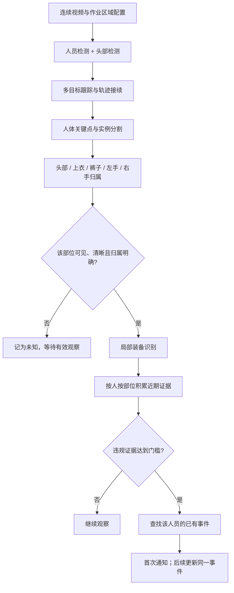

# 通过视觉算法编排去检测到当有人没戴安全帽或者没穿工作服或者没带手套时产生报警

创建时间: 2026年10月16日 22:52

# 作业现场安全穿戴视觉检测方案

## 项目背景与核心难点

检测目标：未戴安全帽、未穿工作服、未带手套

业务约束：同一个人不可重复报警

主要难点

- 多人站一起身体重合，遮挡造成漏检
- 物体遮挡身体，造成误报
- 身份串换、跟踪断连重复报警
- 装备归属混淆，把他人装备算到本人
- 手套小、动作快、场景相似物干扰

核心设计思想

- 看不到装备≠没穿戴
- 检测到装备≠属于某个人
- 编排链路：人员持续跟踪 → 身体部位归属 → 可见性判断 → 装备状态识别 → 多帧确认 → 按人合并报警

## 现存实际业务问题&错误应对

- 多人重叠拥挤：后方人员漏检，错把前方人员装备归给后方
    - 方案：人体+头部联合检测，分人关联身体部位
- 控制柜遮挡身体手臂：看不到装备直接判未穿戴
    - 方案：每个部位独立做可见性判断
- 栏杆遮挡腰腿部：人体检测框分割不完整
    - 方案：支持局部人体跟踪，上衣裤子分开判断
- 仅单只手可见：看到一只戴手套判定双手合规
    - 方案：左右手分开维护状态
- 设备表面疑似手套布料：误判人员佩戴手套
    - 方案：手套需要匹配手部、腕部运动关系
- 服装安全帽颜色相近遮挡：身份串换，重复/错误报警
    - 方案：跟踪连续性、轨迹接续、报警身份分层管理
- 单张截图时间片段有限：无法验证跟踪、摘戴、防重复报警
    - 方案：需要连续视频做验证

## 算法编排整体流程

输入：摄像头视频流

人员发现：人体检测 + 独立头部检测

多目标人员跟踪

- 选型：BoT‑SORT（优先）/ByteTrack
- 处理逻辑
    - 全身框缺失，依靠头部+上半身维持轨迹
    - 多人重叠保留原有轨迹，不轻易判定人员离开
    - 遮挡重现：时间、位置、移动方向、外观做轨迹接续
    - 禁止仅靠服装颜色合并人员身份

部位定位：人体关键点 + 实例分割

- 人员维度绑定部位
    - 头部：安全帽
    - 躯干上臂：工作服上衣
    - 腿部：工作裤
    - 左手：左手套
    - 右手：右手套
- 归属判断依据
    - 头肩肘腕位置关系
    - 实例分割人员可见区域
    - 前后帧部位运动一致性
    - 多归属歧义时该部位状态置为未知
- 禁止把模型推测被遮挡部位当作真实可见证据

部位可见性判断

- 判断维度：局部清晰度、部位像素尺寸、遮挡估计、归属可信度
- 关键点置信度不能单独作为可见依据
- 部位级门控，不是整个人遮挡就全部禁用检测

装备识别（三个专用分类模型）

- 安全帽：需要清晰头顶区域，仅脸部/后颈不足
- 工作服：归属本人区域识别，单纯没看到蓝色≠违规
- 手套：裸手清晰可见才判违规；手被遮挡记未知

装备三态定义

- 合规：清晰看到装备满足要求，不可报警
- 违规：清晰看到未穿戴，多帧确认后报警
- 未知：遮挡、模糊、归属不明，不触发报警

多帧确认机制

- 禁止逻辑：连续时间没检测到装备直接报警
- 正确逻辑：窗口内多次有效违规观测，达到条件再报警
- 初始参考参数
    - 视频15帧/s；装备识别抽帧，违规候选提升检查频率
    - 时间窗口2‑5s，多次有效违规观察，证据跨至少1s
    - 遮挡帧不计入合规/违规；旧证据超时失效

报警事件管理层（防重复报警）

- 三层身份标识
    - track_id：短期轨迹id，遮挡会中断变化
    - person_session_id：单次进入现场人员会话id，可绑定多个track_id
    - event_id：报警事件唯一id，用于幂等通知
- 业务规则
    - 同一次作业会话，首次违规触发通知
    - 后续新增违规类型追加到同一事件，不重复通知
    - 遮挡、跟踪断开不视作人员离场，不重置报警状态
    - 持久化存储event_id、已通知状态，防止重试重复推送
- 跨时段身份说明
    - 仅视觉无法可靠实现离开再返回不报警；需要工牌/定位标签
    - 身份不确定不能强行合并人员，避免压掉真实报警

## 两类遮挡专项处理方案

多人互相遮挡

- 维持多条人员轨迹，分别关联各自头部躯干手部
- 只使用归属明确区域做装备识别；归属不明置未知
- 后方人员完全被遮挡，状态置未知；等待姿态变化获取证据
- 客观边界：完全从未被画面拍到，算法无法识别违规

设备物体遮挡（控制柜、栏杆等）

- 仅受遮挡部位状态置未知，其余可见部位正常检测
- 不根据坐标落在遮挡区域直接判定遮挡
- 例：右手被柜子挡，左手正常校验；腿被挡不影响头部安全帽校验

## 模型训练样本要求

- 正样本：合规佩戴安全帽、工作服、手套
- 负样本：多人重叠、柜体遮挡、普通蓝衣服、裸手、护袖、抹布、台面放置手套

## 机位优化建议

当前问题：柜体造成手部、右侧躯干持续盲区

新增机位方案

- 平台入口/上下台阶方向：入场采集完整装备证据
- 操作位置侧前方：补充柜后躯干双手视角

多摄像头注意点

- 先做人员关联，再汇总装备证据；关联不确定不覆盖状态
- 证据冲突需要校验时间、图像质量，不能单摄像头合规即判定整体合规

## 补充难点与验收指标

额外难点

- 手套尺寸小动作快，使用原图局部裁剪识别
- 装备定义：区分“佩戴”和“佩戴正确”
- 相似物体干扰，负样本覆盖
- 统一工服带来身份串换风险
- 历史状态过期，不能复用很久之前证据
- 长期部位不可见，标记无法核验，走人工复核

测试用例：多人单个人违规、单手未戴手套、遮挡后重现报警、两人交换位置

关键验收指标

- 违规事件召回率：真实违规检出比例
- 每摄像头小时误报数
- 重复报警率：同一会话通知次数
- 错人归属率：甲乙装备互相误判
- 有效观察覆盖率：人员部位可核验占比
- 报警延迟：从有效证据到报警通知耗时

---

**全文总结**
本文是一套工地/作业现场人员安全穿戴视觉检测工程方案，目标是通过视频视觉算法识别人员未佩戴安全帽、未穿工作服、未佩戴手套的违规行为，并且实现同一个人员单次进场不会重复报警。方案直面两大核心难题：多人相互身体遮挡造成漏检、物体遮挡身体引发误报，并确立了两条核心原则：看不到装备不等于人员没有穿戴装备，检测到装备也不能直接判定装备属于某个人。整体采用“人员持续跟踪 → 身体部位归属 → 可见性判断 → 装备状态识别 → 多帧确认 → 按人合并报警”的算法编排链路，将安全帽、工作服、手套的装备状态划分为合规、违规、未知三态，遮挡、归属不清的情况标记为未知，不触发报警。方案详细设计了人员跟踪、部位归属、遮挡处理、多帧证据校验、报警事件分层管理的逻辑，区分人员互相遮挡和设备物体遮挡两种场景差异化处理，使用BoT-SORT或ByteTrack作为跟踪基线，依靠头部+人体联合检测提升拥挤场景识别能力。同时明确三层身份标识track_id、person_session_id、event_id来解决遮挡导致跟踪ID切换而产生重复报警的问题，同一次人员作业会话只推送一次通知，新增违规类型追加至原有事件。方案还分析了手套识别、相似物体干扰、统一工装身份混淆等额外难点，给出机位优化建议，定义召回率、误报数、重复报警率等验收指标，并提供完整落地实现流程，同时说明该方案目前仅为工程设计，还需要现场连续视频验证效果，纯视觉方案无法实现跨时段人员精准识别，跨场次身份校验需要搭配工牌、定位标签等辅助手段。

**重要亮点**

- **核心设计原则与三态装备状态机制**：整套算法最核心的两条准则，看不到装备不能直接判定人员未穿戴，检测到装备也不能直接判定装备归属，以此专门解决遮挡带来的误报与漏报问题。方案将安全帽、工作服、手套检测结果分为合规、违规、未知三种状态，只有清晰观测到对应部位且证据充分，才判定合规或者违规；遇到遮挡、图像模糊、部位归属存在歧义的场景，统一标记为未知状态，未知状态不会触发报警。其中安全帽需要完整清晰头顶区域证据，工作服需要归属本人的有效衣物区域，手套需要清晰裸手画面才能判定违规，只要手部被遮挡就记为未知，该机制从根源上避免因画面盲区直接推断违规的错误逻辑。
- **人员跟踪与部位归属方案，解决多人拥挤重叠问题**：方案采用人体检测叠加独立头部检测的方式，多人拥挤身体重叠、全身检测框缺失时，依靠头部与上半身维持人员轨迹，选用BoT-SORT或ByteTrack多目标跟踪算法，人员遮挡重现后依靠时间、位置、移动方向、外观信息做轨迹接续，禁止仅凭服装颜色合并人员身份。同时结合人体关键点与实例分割，把安全帽、工作服、左右手手套绑定到对应的人体部位，综合位置关系、可见区域、帧间运动一致性判断装备归属，若部位归属存在多个人选，则该部位状态置为未知，杜绝把前方人员的工作服错误判定为后方人员穿戴的常见错误。
- **分类型遮挡差异化处理逻辑，实现部位级可见性门控**：方案把遮挡场景分为人员互相遮挡和设备物体遮挡两类分别处理。多人互相遮挡场景下，维持多条独立人员轨迹，仅使用归属明确区域识别装备，完全被遮挡人员对应部位标记未知；设备如控制柜、栏杆遮挡场景，只将被遮挡的单个部位状态置为未知，其余可见部位正常检测，不会因为一处遮挡就停止整个人的检测。判断遮挡不能只依靠坐标落在设备遮挡区域，而是结合局部清晰度、像素尺寸、遮挡估算、归属可信度综合判断，关键点置信度不能单独作为可见依据，模型推测出的被遮挡隐藏部位不能当作真实检测证据。
- **多帧证据确认机制，规避单帧图像误触发报警**：方案摒弃连续一段时间检测不到装备就直接报警的简单逻辑，采用滑动时间窗口累计有效观测证据。以2~5秒作为证据窗口，需要窗口内多次有效违规观测，证据需要跨越至少1秒时间，遮挡帧不计入合规或者违规的有效样本，旧证据会随时间过期失效。装备识别支持按算力抽帧，发现违规候选目标后提升局部检查频率，同时不能将高度相似相邻帧当作多条独立证据，参数属于初始调试值，可根据现场的漏报、误报情况与报警延迟要求调整，大幅降低瞬时画面噪声带来的误报警。
- **三层身份标识事件管理，实现同人员单次进场不重复报警**：单纯依靠跟踪track_id无法解决遮挡导致ID切换、重复报警问题，方案设计三层标识：track_id是短期轨迹编号，遮挡会中断；person_session_id代表人员单次进入现场的会话身份，可以关联多个track_id；event_id是报警事件唯一编号。业务规则为同一次作业会话仅首次违规触发通知，后续新增违规类型追加到同一事件，不重复推送通知，遮挡、跟踪断开不代表人员离场，不会重置报警状态。报警事件、通知状态持久化存储，依靠event_id实现消息幂等，防止网络重试、服务重启重复推送通知；同时明确纯视觉无法可靠实现离场再返回的身份识别，跨时段身份校验需要工牌或定位标签。
- **机位优化、训练样本与量化验收指标，支撑方案落地验证**：现有机位容易出现柜体遮挡手部、躯干的持续盲区，方案建议新增平台入口机位，在人员入场时采集完整装备信息，增加操作区侧前方机位，补充柜后躯干与手部视角，多摄像头场景需要先完成人员关联再汇总证据，身份不确定时不能互相覆盖装备状态。模型训练样本需要纳入多人重叠、柜体遮挡、裸手、护袖、台面放置手套等正负样本。同时定义可量化验收指标，包括违规召回率、每小时误报数、重复报警率、错人归属率、有效观察覆盖率、报警延迟，测试用例覆盖多人单个人违规、遮挡重现报警等场景，保障方案效果可评估。

析图片场景，思考一下：怎么通过视觉算法编排去检测到当有人没戴安全帽或者没穿工作服或者没带手套时产生报警，同一个人不可以重复报警。难点包括但不限于1.几个人站在一块会产生遮挡，从而导致两个人或几个人身体重合导致有人没穿工作服没有检测出来的情况。2.不能因为工作人员的身体被场景中的物品遮挡而产生误报。其余的你可以自己补充。

Worked for 4m 10s

这组场景建议采用 **“人员持续跟踪 → 身体部位归属 → 可见性判断 → 装备状态识别 → 多帧确认 → 按人合并报警”** 的编排。

核心有两个：**看不到装备，不能直接判定没穿戴；检测到了装备，也不能直接判定它属于某个人。** 你提出的遮挡漏报和遮挡误报，分别与这两点有关。

以下是结合画面的具体设计。它是工程方案，尚未用你现场的连续视频验证效果。

**一、这些画面暴露出的实际问题**

| 画面情况 | 容易出现的错误 | 应对方式 |
| --- | --- | --- |
| 第一张图中三个人挤在平台上，身体明显重叠 | 后面的人漏检；把前面人的蓝色工作服算到后面的人身上 | 人体、头部联合检测，分人关联身体部位 |
| 中间控制柜长期挡住身体和部分手臂 | 把“没有看到工作服或手套”判成未穿戴 | 每个部位单独判断可见性 |
| 栏杆遮住腿部、腰部 | 整个人的检测框或分割结果不完整 | 允许局部人体跟踪；上衣、裤子分别判断 |
| 多张图中只有一只手比较清楚 | 看见一只戴手套，就判定双手合规 | 左右手分别维护状态 |
| 设备表面有浅色布料或疑似手套物品 | 把放在机器上的物品判成工作人员戴着手套 | 手套必须与手部、腕部及运动关系匹配 |
| 人员服装、安全帽颜色相近 | 遮挡后身份串换，导致重复报警或错人抑制 | 跟踪连续性、轨迹接续和报警身份分层管理 |

第一张图右后方人员的头顶看起来没有明显安全帽，可以作为“未戴帽候选”；正式报警仍应结合清晰局部和连续帧确认。

另外，`10_14_000001` 到 `000019` 的时间大约间隔 5 秒。它们有助于理解场景，但**不足以检验跟踪是否稳定、摘戴动作是否漏掉、报警是否重复**。这些需要连续视频。

**二、建议的算法编排**

```

```

这些模块不一定全部由独立模型实现，但逻辑职责需要分开。尤其不能直接把一个“人体框内有没有蓝色衣服”的结果用于报警。

**1. 先把人分开，并保持连续身份**

人员检测要结合头部检测。三个人挤在一起时，全身检测可能只给出两个框，但三个可见头部可以提示存在第三个人。

具体处理：

- 全身检测不完整时，允许依靠头部和可见上半身建立或维持局部轨迹。
- 多人重叠时，保留已有人员轨迹，不因为暂时少了一个人体框就认定人员离开。
- 从遮挡后重新出现时，结合时间、位置、移动方向和外观进行轨迹接续。
- 禁止仅凭“都穿蓝衣服”合并身份。

跟踪基线可以比较 ByteTrack 和 BoT-SORT：前者利用低置信度检测参与关联，后者结合运动和外观信息。它们能作为实现基础，但现场统一着装与长时间遮挡仍需专门验证。[ByteTrack 论文](https://arxiv.org/abs/2110.06864)、[BoT-SORT 论文](https://arxiv.org/abs/2206.14651)。

**2. 装备必须绑定到具体身体部位**

每个人分别维护：

```
人员A
  头部 → 安全帽
  躯干与上臂 → 工作服上衣
  腿部 → 工作裤（若现场要求）
  左手 → 左手套
  右手 → 右手套
```

关联时综合考虑：

- 头部、肩部、肘部、腕部之间的位置关系。
- 实例分割得到的当前人员可见区域。
- 前后帧中部位的运动是否一致。
- 是否同时存在两个合理归属对象。

**如果同一只手或同一块衣服可能属于两个人，就暂时不用于判定任何一人的合规状态。**

例如，A 的人体框包含了 B 的蓝色衣服，不能因此判定 A 穿着工作服。应该只检查能够归属到 A 的躯干或袖子区域；归属不了，则 A 的上衣状态为“未知”。

关键点和分割也会出错，不能把模型推测出来的隐藏手腕、隐藏躯干，当成真实可见证据。

**3. 每个装备项目使用三种状态**

| 状态 | 含义 | 能否触发违规报警 |
| --- | --- | --- |
| 合规 | 清楚看到该部位装备满足要求 | 否 |
| 违规 | 清楚看到该部位未穿戴，或装备不符合定义 | 多帧确认后可以 |
| 未知 | 遮挡、模糊、像素不足、归属不明 | 不能据此触发 |

对应到三个任务：

- *安全帽：**看到足够清楚的头顶及头部区域，并有明确未戴帽证据，才能判违规。只看到脸或后颈不够。
- *工作服：**看到属于此人的有效衣物区域，明确识别为不符合要求的服装，才能判违规。仅仅没检测到蓝色不够；普通蓝色衣服也不一定符合工作服要求。
- *手套：**清楚看到裸手，可以判该手违规。手藏在背后、伸入设备、被工具挡住或只看到护袖，都应记为未知。

假设要求双手戴手套：

```
任一手明确违规 → 手套项目违规
双手都有足够新鲜的合规证据 → 手套项目合规
其余情况 → 手套项目未知
```

左右手不必同一帧都出现，但证据需要在有限时间内有效，不能用几分钟前的左手状态与现在的右手状态拼出“当前双手合规”。

**三、如何针对两类遮挡处理**

**多人互相遮挡：避免把别人的合规证据借给当前人员。**

以三个人站在一起为例：

1. 尽量维持三条人员轨迹。
2. 分别关联各自头部、可见躯干和手部。
3. 对每个人，只使用归属明确的区域识别装备。
4. 后方人员身体完全被挡住时，上衣状态记为未知。
5. 当人员侧身、抬手或走开时，补充新的有效证据。

这里存在客观边界：**如果某个人没穿工作服，但他的衣服从进入到离开都没有被任何摄像头拍到，单目算法无法可靠发现。** 实例分割、姿态估计都不能恢复从未被观察到的真实衣物。

因此，“避免遮挡误报”可以通过未知状态实现；“进一步减少遮挡漏报”还需要改善观察机会。

**设备遮挡：只暂停受影响部位的判断。**

建议配置平台、上下台阶通道、操作位置等区域，同时标注控制柜、立柱、大型设备等容易形成遮挡的位置。

但注意：

- 遮挡配置只用于辅助判断，不能把整个操作区直接排除。
- 人可能走到控制柜前面，不能只因图像坐标落在控制柜区域就判定被遮挡。
- 腿被栏杆挡住，不影响判断清晰可见的头部。
- 右手被柜子挡住，不影响对清晰可见的左手进行检查。

因此应采用**部位级可见性门控**，而不是“一有人被挡住就停止所有检测”。

可见性可结合局部清晰度、部位像素尺寸、遮挡估计和归属可信度判断。单独使用“关键点置信度”不够，因为姿态模型可能推测出实际上被挡住的关节。

**四、多帧确认：只累计有效观察**

不能使用这种逻辑：

```
连续3秒没有检测到手套 → 报警
```

应使用：

```
最近一段时间内，
多次清楚观察到属于这个人的裸手，
且证据达到持续时间和置信度要求 → 报警
```

可作为调试起点的设置是：

- 跟踪使用相对连续的视频帧。
- 装备识别按算力抽帧，候选违规出现后增加局部检查频率。
- 在最近 2～5 秒窗口内，要求多次有效违规观察，并跨越一定时间。
- 遮挡帧不计入违规，也不计入合规。
- 窗口内有效观察不足，则保持未知或待确认。

这些数值只是初始实验参数，需要根据现场漏报率、误报率和可接受延迟调整。不能把相邻的几张高度相似图片当成多个独立证据，也不能把间隔很久的零散裸手画面无限累积。

**五、“同一个人不重复报警”必须放在事件层解决**

仅给检测框加 `track_id` 不够。遮挡后换了跟踪编号，系统就可能再次报警。

建议分三层：

| 标识 | 用途 |
| --- | --- |
| `track_id` | 当前连续轨迹编号，可能因遮挡中断 |
| `person_session_id` | 一个人在本次进入现场期间的身份，可关联多个轨迹 |
| `event_id` | 这个人在本次会话中的报警记录 |

按你“同一个人不可以重复报警”的要求，我建议先采用：**同一个人单次进入作业区域，只主动报警一次，后续违规追加到同一条记录。**

举例：

| 过程 | 系统行为 |
| --- | --- |
| 首先确认 A 未戴安全帽 | 创建事件并通知一次 |
| A 持续未戴安全帽 | 更新持续时间，不重复通知 |
| 后续确认 A 未戴手套 | 在同一事件追加“未戴手套”，不新增通知 |
| A 被控制柜遮住 | 保留事件，不视为整改，也不重新报警 |
| A 出现后跟踪编号改变 | 成功接续身份后沿用原事件 |
| A 已明确整改 | 记录整改时间，保留本次会话已通知标记 |

实现上还应让消息发送使用稳定的事件标识做幂等去重，防止程序重试、网络重连或服务重启造成二次通知。报警记录与已通知状态需要持久化。

这里还需要区分：

- *本次进入只报一次：**可以通过人员会话管理实现。
- *同一天、跨摄像头或离开再返回也只报一次：**需要更稳定的跨时段身份关联。
- *永久只报一次：**意味着此人以后再次违规也不通知，一般不宜作为默认业务规则。

仅凭当前视角中的蓝色工服与安全帽，无法保证长时间离场后仍准确认出同一个人。若要求严格跨时段去重，需要结合工牌、定位标签或出入口身份信息。身份不确定时，不能为了减少重复而把两个不同人员强行合并，否则会压掉新人员的报警。

**六、对这个现场，机位改进应重点解决手部与柜后身体**

现有视角适合观察平台整体和多数头部，但中间柜体让右侧身体、手部形成持续盲区。

若允许增加机位，优先考虑：

- *平台入口或上下台阶方向：**在人员聚集前获取较完整的个人装备证据。
- *操作位置的侧前方：**补充控制柜后方躯干及双手的观察。

具体安装点需要现场验证视线、设备运动范围和光照条件。入口检查也不能替代作业中的检查，因为人员可能进入后摘帽或脱手套。

多摄像头情况下，先可靠关联人员，再汇总证据；关联不确定时不互相覆盖装备状态。同一人在不同画面中的证据冲突时，要检查时间差、图像质量和身份匹配，不能简单采用“任一摄像头说合规就算合规”。

**七、还应补充的难点与验收方式**

除遮挡外，我认为还有这些重点：

- *手套尺寸小、动作快：**应从原始分辨率裁剪手部识别；单纯放大模糊图片不会增加真实细节。
- *装备定义不清：**需要明确允许的安全帽、上衣、工作裤、手套类型，以及是否检查正确佩戴；“戴了”与“戴对了”是不同任务。
- *相似物干扰：**浅色抹布、护袖、手持手套、放在台面的安全帽都要进入训练负样本。
- *统一着装造成身份串换：**必须专门测试多人交叉、并排、完全遮挡后重现。
- *历史状态过期：**曾经戴着不能代表现在戴着；曾经报警也不能代表已整改。
- *长时间不可见：**记录“无法核验”及覆盖率，必要时进入人工复核流程，不能把它当成穿戴合规。

验收应使用连续视频中的完整事件，至少包含“多人中只有一人违规”“单手未戴手套”“人合规但身体被柜子挡住”“报警后遮挡重现”“两人交换位置”等片段。数据集应按视频片段或日期划分，避免相邻帧同时进入训练和测试。

最值得关注的指标是：

| 指标 | 要回答的问题 |
| --- | --- |
| 违规事件召回率 | 真实发生的违规有多少被发现？ |
| 每摄像头小时误报数 | 现场每天会被多少次错误提醒打扰？ |
| 重复报警率 | 同一人同一会话被通知了多少次？ |
| 错人归属率 | 是否把甲的装备或违规算给乙？ |
| 有效观察覆盖率 | 人在场期间，哪些部位实际上能够核验？ |
| 报警延迟 | 从首次具备可判断证据到通知需要多久？ |

**这套方案最关键的验收要求是：既不能把“未知”算成违规制造误报，也不能把“未知”算成合规来掩盖漏检。** 对你这组场景，先把逐人归属、部位可见性和事件去重做好，再根据实际观察覆盖率决定是否补机位，才有可能得到稳定可用的报警系统。

直接给我实现方案+简单解释

采用 **“人员跟踪＋部位可见性判断＋装备识别＋时间确认＋事件去重”**，具体实现如下。

**1. 模型与处理流程**

```
摄像头视频
  ↓
人员、头部检测
  ↓
多目标跟踪，为每个人建立持续身份
  ↓
人体关键点＋人员实例分割
  ↓
提取此人的头部、躯干、左右手
  ↓
判断部位是否可见、清晰、归属明确
  ├─ 不满足 → 未知，继续观察
  └─ 满足 → 识别安全帽、工作服、手套
                ↓
           多帧确认违规
                ↓
         创建或更新该人的报警事件
```

| 模块 | 实现方式 | 作用 |
| --- | --- | --- |
| 人员发现 | 人体检测＋独立头部检测 | 身体重叠时，尽量不漏掉后方人员 |
| 人员跟踪 | BoT-SORT，结合运动与外观关联 | 人移动、短暂遮挡后继续跟踪 |
| 部位定位 | 人体姿态估计＋实例分割 | 找到属于每个人的躯干和手部 |
| 可见性判断 | 局部可见性分类，结合清晰度、尺寸和关联置信度 | 被柜体、人员遮挡时不误报 |
| 装备识别 | 头部、躯干、手部三个专用分类模型 | 分别识别戴帽、工作服、手套 |
| 报警管理 | 人员会话＋持久化事件记录 | 同一个人只通知一次 |

装备模型使用现场数据微调，必须包含多人重叠、柜体遮挡、普通蓝衣服、裸手、护袖、抹布和放在台面的手套等样本。

**2. 每个人独立维护装备状态**

```
person_session_id
├─ helmet：合规 / 违规 / 未知
├─ uniform：合规 / 违规 / 未知
├─ left_glove：合规 / 违规 / 未知
├─ right_glove：合规 / 违规 / 未知
├─ track_ids：关联过的跟踪编号
├─ event_id：报警事件编号
└─ notified：是否已通知
```

判断规则：

- *没戴帽：**头部清楚可见，并明确识别为未戴安全帽。
- *没穿工作服：**属于此人的躯干清楚可见，并明确识别为非规定工作服。若要求工作裤，增加独立裤装检查。
- *没戴手套：**任意一只手清楚可见，并明确识别为裸手。
- *遮挡、模糊或不知道部位属于谁：**记为未知，不触发违规，也不认为合规。

**简单解释：不能用“没检测到装备”代替“明确看到未穿戴”。**

**3. 两类遮挡的具体处理**

| 情况 | 处理逻辑 |
| --- | --- |
| 两个人身体重叠 | 根据头部、肩膀、手臂连接关系和实例分割，将衣物及手部绑定到对应人员 |
| 前方人员的工作服落入后方人员检测框 | 不按整个框判定；只检查归属于后方人员的可见躯干 |
| 部位归属存在歧义 | 暂停该部位判断，等待人员分开或姿态变化 |
| 控制柜挡住躯干 | 工作服状态为未知，仍可检查可见的头部 |
| 一只手被设备遮挡 | 被挡手为未知，另一只手正常检查 |
| 人短暂完全消失 | 保留轨迹候选及报警记录，重现后尝试接续身份 |

分割和姿态模型推测出的隐藏部位，不能作为穿戴证据。

**4. 多帧确认参数**

以下参数作为初始配置，之后用现场视频调整：

| 参数 | 初始值 |
| --- | --- |
| 人员检测与跟踪 | 处理约 15 帧/秒 |
| 装备识别 | 每人每秒约 5 次，从原图裁剪局部 |
| 证据窗口 | 最近 3 秒 |
| 违规确认 | 至少 5 次有效观察，其中至少 80% 判违规，且违规证据跨度不少于 1 秒 |
| 无效观察 | 不参与投票，旧证据随窗口过期 |
| 长期不可判断 | 记录“无法核验”，供复核和机位优化 |

**简单解释：只对“看清楚了”的结果投票，避免单帧误检和遮挡触发报警。**

**5. 去重：同一人单次进入只报警一次**

不要直接用跟踪算法的 `track_id` 去重，应建立稳定的 `person_session_id`，允许一个人员会话关联多个断续轨迹。

```
for person in tracked_people:
    session = resolve_person_session(person)

    for item in ["helmet", "uniform", "left_glove", "right_glove"]:
        observation = inspect_owned_part(person, item)

        if observation.visible and observation.owner_certain:
            session.add_evidence(item, observation)

    violations = session.confirm_recent_violations()

    if violations:
        # 首次创建，后续追加违规类型和证据
        event = upsert_event(session.id, violations)

        # 事件唯一键＋持久化发送状态，防止重试重复通知
        notify_once(event.id)
```

例如：

```
发现未戴帽 → 通知一次
持续未戴帽 → 更新原事件
随后发现未戴手套 → 追加到原事件，不再次通知
被柜子挡住后重现 → 接续原人员会话，不再次通知
```

数据库对 `person_session_id` 设置报警事件唯一约束，通知使用 `event_id` 做幂等去重。遮挡或跟踪断开不能直接当作人员离场。

**6. 你这个现场的落地配置**

先用现有摄像头实现上述流程，并重点测试“三人重叠”“柜后操作”“单手裸露”“遮挡后重现”。

如果实际视频中躯干或手部长时间完全不可见，增加一个**操作区侧前方机位**，补看柜后身体和双手。算法无法判断从未拍到的装备状态。

这里默认去重范围为**同一人单次进入作业区域**。若要求跨天、离开再回来也不重复，需要接入工牌或定位身份；仅靠相似工服的画面无法保证准确去重。